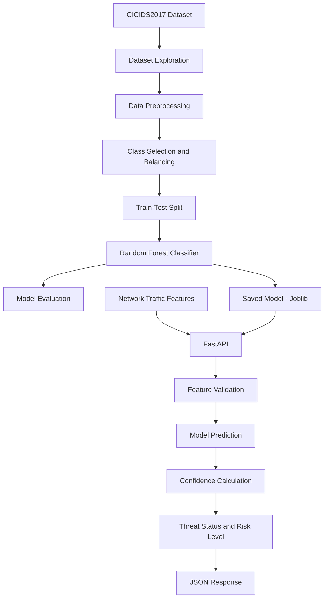

# NetworkML 🛡️

### Machine Learning-Based Network Intrusion Detection System

NetworkML is a Machine Learning project designed to identify and classify potentially malicious network traffic using network flow characteristics.

Built using the **CICIDS2017 dataset**, the project explores how supervised Machine Learning can distinguish normal network activity from different types of cyber threats.

The system combines a data exploration and model-training pipeline with a **FastAPI-based prediction service**, allowing users to submit network traffic features and receive threat classifications along with confidence and risk-level information.

---

## 🎯 Problem Statement

Modern networks generate large volumes of traffic, making it challenging to manually identify suspicious activities and potential cyber threats.

NetworkML explores an automated approach to network intrusion detection by training a Machine Learning model to recognize patterns associated with malicious traffic.

The objective is to classify incoming network traffic into categories such as:

- **BENIGN** – Normal network traffic.
- **DDoS** – Distributed Denial of Service attacks.
- **PortScan** – Network scanning activity.
- **DoS Hulk** – Denial of Service attacks associated with Hulk.

## ✨ Key Features

### 1. Network Traffic Analysis

- Uses the CICIDS2017 intrusion detection dataset.
- Analyses network flow characteristics.
- Explores benign and malicious traffic distributions.
- Examines missing values, infinite values and duplicate records.

### 2. Data Preprocessing

- Selects four traffic categories for the initial model.
- Samples and balances the selected classes.
- Handles infinite values and missing records.
- Separates input features from target labels.
- Uses stratified train-test splitting.

### 3. Machine Learning-Based Threat Classification

- Implements a Random Forest Classifier.
- Uses 100 decision trees.
- Trains on 78 network traffic features.
- Classifies traffic into four categories.

### 4. FastAPI Prediction Service

- Loads the trained model using Joblib.
- Accepts network traffic features through a REST API.
- Validates that all required model features are provided.
- Maintains the feature order expected during training.
- Returns predictions and class probabilities.

### 5. Threat Assessment

The prediction API also provides additional information:

- Predicted traffic category.
- Prediction confidence.
- Threat status.
- Risk level based on model confidence.

---

## 🏗️ System Architecture

The project follows a modular architecture that separates data preparation, model training, and prediction serving.

### Main Components

| Component | Responsibility |
|---|---|
| Dataset Exploration | Examines network traffic data and distributions |
| Preprocessing Pipeline | Cleans and prepares data for training